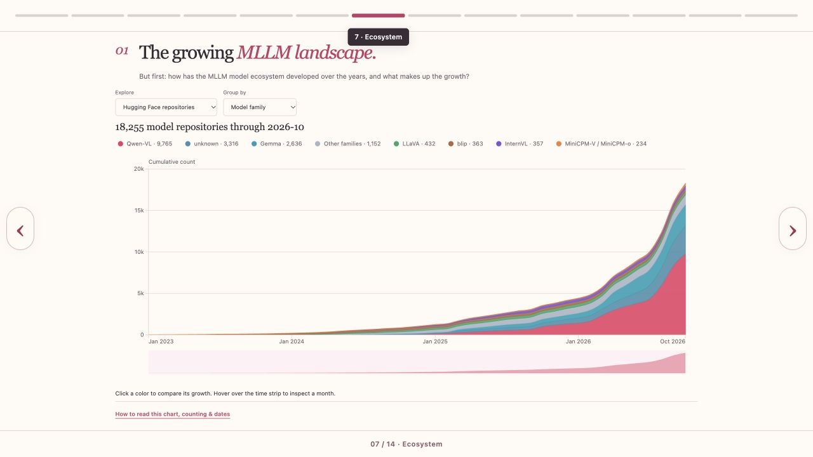
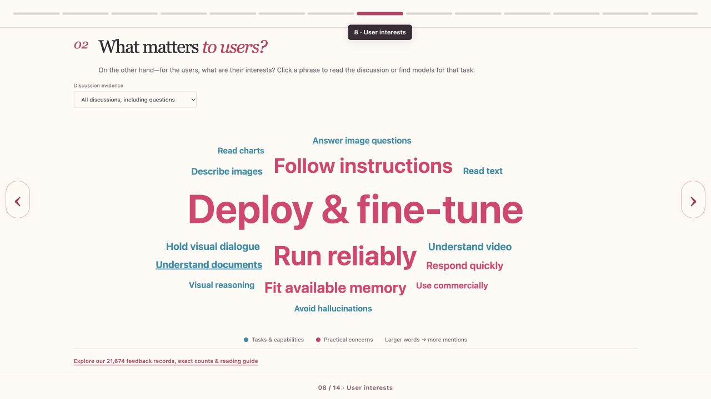
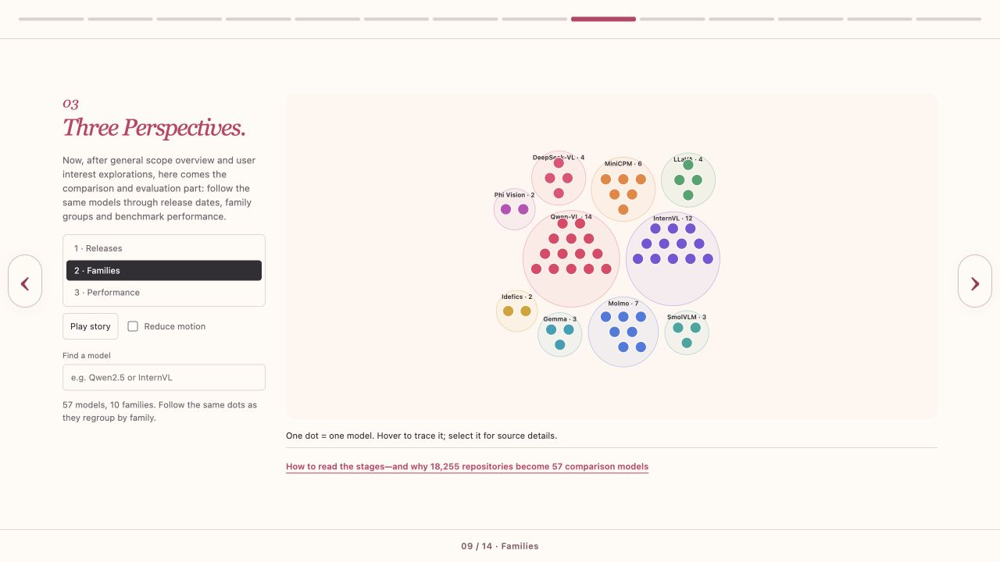
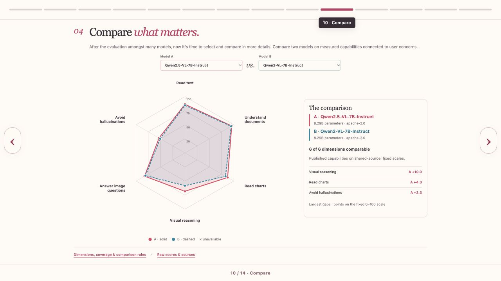
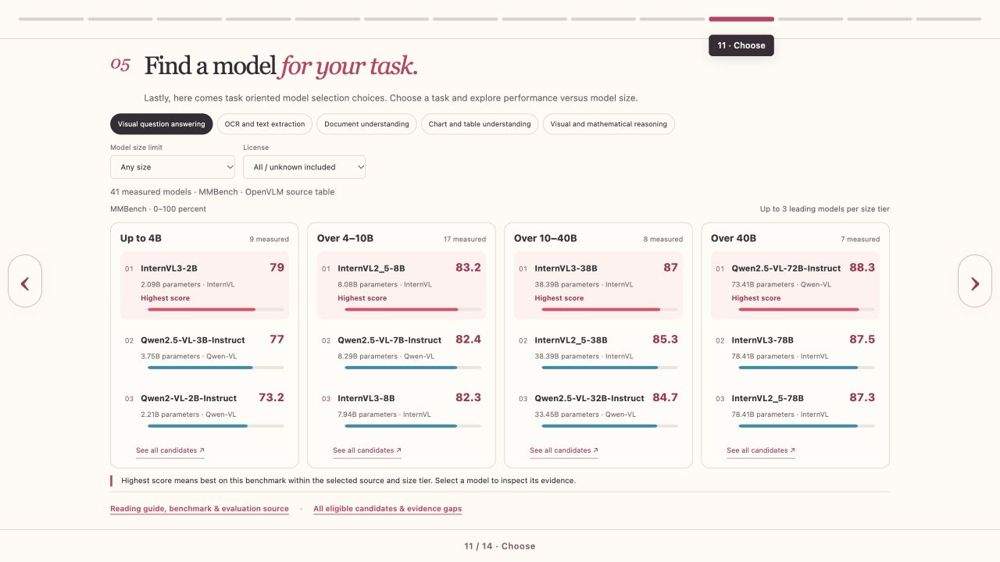

# MLLMs: Which Model for Your Task?

STATS 401 · Group 7 · Sean Wan, Yuxuan Huang, Shilin Ou

[Interactive website](https://seanwan514.github.io/stats401-fp-7-mllm-evo-vis/) · [Project repository](https://github.com/SeanWan514/stats401-fp-7-mllm-evo-vis)

## Introduction

Choosing an open-weight multimodal large language model (MLLM) requires more than finding the highest leaderboard score. Researchers and developers must reconcile task capabilities, model size, licensing, practical difficulties and incomplete evidence. MLLMs combine language with another modality; our project focuses on image-and-text applications such as reading documents, interpreting charts and answering visual questions. Open-weight availability enables experimentation but does not guarantee unrestricted licensing or suitability for deployment.

Our central question is: **Which models deserve testing for a particular task and parameter-size budget, and what evidence supports that choice?** Supporting questions ask how the repository ecosystem has developed, what users discuss, how canonical models relate by family and release period, and where measured capabilities differ.

Visualization is appropriate because these questions involve temporal change, categorical structure, multidimensional comparison and missing information. Our fourteen-page website takes the audience from context and ecosystem overview through community concerns, model exploration and capability comparison to task-specific choices. The goal is an evidence-based shortlist for further testing, rather than a universal winner.

## Method

The collection snapshot is 17 October 2026. We used Hugging Face model APIs, metadata and model cards, GitHub issue/comment APIs, and Hugging Face discussion events. Collectors used pagination, bounded queries and retries, cached evidence, and retrieval timestamps. Repository discovery combined popularity- and recentness-oriented queries; consequently, the collection is a bounded sample of visible repositories, not a historical census.

For model metadata, 24,182 API observations became 20,497 unique repository IDs and then **18,255 retained repositories** after relevance filtering. We excluded identified test/random-weight, text-only and incompatible-modality records. Metadata-supported family and repository-type rules distinguished original distributions, fine-tunes, adapters and quantizations while preserving uncertainty. Repository creation dates were not substituted for verified model release dates.

For community evidence, 45,047 observations became 37,738 distinct source objects and **21,674 retained posts/comments**: 19,547 from GitHub and 2,127 from Hugging Face. Cleaning removed duplicates, known maintainers/bots, acknowledgements and off-scope material. English/Chinese rules identified tasks, practical concerns and reported experiences/problems. A record can receive multiple labels; family-level associations remain separate from exact-model associations. These records include questions, not just reviews, and their labels lack measured human accuracy.

A curated registry contains 57 canonical models across ten families, including 49 with day-verified release dates. OpenVLM baseline data and official model sources supplied reported benchmark measurements; we did not rerun evaluations. Transformations standardized identifiers, units and source comparison groups while retaining missing scores and incomplete settings. Python processing generated compact JSON aggregates for custom D3.js 7, SVG, HTML, CSS and JavaScript views.

Aggregation counts each record once per concern across the full cleaned corpus; displayed excerpts are only a capped sample. Benchmark values use fixed published ranges, including OCRBench's 1,000-point scale, rather than filter-dependent normalization. Shared identifiers connect model, family, task and source records without promoting family-level comments into model-specific evidence.

The repository provides cleaned datasets, preserved source caches, provenance and checksums. Not every initial full API response survived; normalized records and later archives are documented separately. GitHub Actions validates and deploys the static website to GitHub Pages. Technical verification included 65 regression tests, data-integrity checks and local desktop/mobile interaction checks; these establish implementation consistency, not usability or label accuracy.

## Results

### 1. Ecosystem growth

Smooth cumulative stacked areas show repository growth, grouped by family or repository type. A separate mode shows verified canonical releases. Users select a category to move it to the baseline and inspect months through the time strip, answering how much the ecosystem has expanded and what comprises that expansion.

The important distinction is between repository proliferation and independent innovation: **10,722 retained repositories, or 58.7%, are classified as quantizations**. The sharply rising total therefore includes adaptations of existing models. Beginning the repository display in January 2023 removes empty-looking space without discarding earlier records from the cumulative baseline.

*Figure 1. Ecosystem growth: cumulative repository counts by family.*

### 2. Community concerns

The interactive phrase cloud represents fifteen rule-defined concerns. Type size encodes distinct-record mention counts; color distinguishes task/capability concerns from practical concerns. Users switch between all discussions and reported-use/problem records, select phrases for source excerpts, and follow supported task links into model selection.

“Deploy & fine-tune” appears in **11,062 records**, and “Run reliably” in **6,086**. These prominent practical concerns demonstrate why benchmark accuracy alone cannot address the collected discussions. They do not establish population-wide priorities: support forums attract troubleshooting, categories overlap, and phrase position is decorative. Exact counts and collection details remain available in a dialog.

*Figure 2. Community concerns: phrase size reflects distinct-record mentions.*

### 3. Three Perspectives

The same 57 equal-sized model dots transition among a release timeline, hierarchical family groups and benchmark-performance distributions. Stable identities and family colors support tracing; search highlights without removing context, while selection opens model evidence. Performance controls change the benchmark and source group, with unavailable scores visibly separated.

The family stage reveals uneven representation: Qwen-VL contributes fourteen models and InternVL twelve, compared with two each for Idefics and Phi Vision/Multimodal. These are properties of our curated comparison set, not ecosystem market shares. Regrouping makes the distinction between chronological development, family membership and measured performance explicit; proximity within a family does not establish ancestry or comparable capability.

*Figure 3. Three Perspectives: persistent model dots grouped into ten families.*

### 4. Concern-led capability comparison

The radar compares two models across six user-concern-aligned benchmark proxies: text reading, documents, charts, visual reasoning, visual question answering and hallucination-related evaluation. Users select eligible pairs, inspect raw scores/sources and optionally switch to an eight-benchmark profile. Pairs require at least four shared measured dimensions; unavailable values remain gaps.

For Qwen2.5-VL-7B versus Qwen2-VL-7B in their shared official source, MathVista scores are **68.2 versus 58.2**, whereas DocVQA scores are **95.7 versus 94.5**. The unequal gaps show why task-specific comparison is more informative than one headline improvement. Concern mentions determine relevant questions, not performance ratings; speed and memory remain unmeasured.

*Figure 4. Concern-led comparison: fixed-scale profiles and task-dependent differences.*

### 5. Task-oriented model selection

The final view translates exploration into candidate selection. Five tasks with usable measurements lead to rankings within four parameter-size tiers: up to 4B, over 4–10B, over 10–40B and over 40B. Separate rows and consistent score bars avoid scatterplot overlap. Users filter size/license constraints, inspect candidate evidence and open the complete eligible-candidate table, including gaps.

Under the default visual-question-answering/OpenVLM MMBench selection, InternVL3-2B leads the smallest tier at **79**, while Qwen2.5-VL-72B leads the largest at **88.3**. This makes the score–size tradeoff concrete without equating parameters with hardware cost. Up to three top-ranked candidates per tier provide manageable starting points; unsupported tasks are not offered fabricated rankings.

These are benchmark proxies: MMBench does not cover every visual-question-answering workflow, and ChartQA cannot certify arbitrary table-understanding applications. Candidate rankings therefore guide application-specific testing rather than replace it.

*Figure 5. Task-oriented selection: leading measured candidates within parameter-size tiers.*

## Discussion

The What–Why–How framework clarifies our design. **What** comprises temporal repository/release records, categorical families and concerns, numerical counts/parameters/scores, and textual evidence with provenance. **Why** is to discover ecosystem patterns, identify relevant concerns, compare capabilities and select candidates. **How** combines stacked areas, sized text, temporal/hierarchical point layouts, radar profiles and grouped ranked bars. Filtering, category reordering, search highlighting, stage switching, selection, cross-view task links and details on demand support these analytical tasks beyond tooltips.

Each idiom has tradeoffs. Stacked areas make non-baseline categories harder to compare; baseline reordering helps. Clouds are engaging but imprecise for numerical comparison, so exact counts remain accessible. Persistent dots preserve identity, although animation can increase tracking effort; direct stage controls and reduced-motion support provide alternatives. Radar shape encourages profile comparison but polygon area must not be interpreted as overall quality. Fixed scales and raw-score tables reduce, but cannot eliminate, this risk. Size-tier rankings avoid overplotting, yet tier boundaries and three-row summaries can obscure alternatives; the complete table preserves access.

The page sequence and centered evidence dialogs reduce clutter while maintaining provenance. They also introduce a discoverability cost: readers must actively open methodological detail. The Pudding's staged storytelling and Dancing Histograms' baseline comparison informed the design; our implementation uses custom D3 layouts.

Evidence limits remain substantial. Only **1,965 records (9.1%)** have task labels and **1,507 (7.0%)** associate with canonical models. Support-forum bias, rule errors, incomplete benchmark settings and curated-model selection constrain generalization. A common source table improves comparison discipline but does not establish controlled replication. Sean's formative reviews motivated redesign; one project-member reviewer cannot establish independent usability. Next steps are independent task-based testing, human annotation checks, broader discussion sources and controlled latency/memory measurements.

Future evaluation should measure whether new users can find a size-constrained candidate and correctly explain its evidence gaps, recording completion, errors and interpretation rather than relying only on visual preference.

## Conclusion

The project shows that ecosystem expansion, user concerns and measured capability answer different parts of model selection. Repository growth includes extensive adaptation; practical deployment concerns extend beyond benchmark accuracy; and performance advantages depend on the task and evidence source. Combining these perspectives helps researchers and developers move from an overwhelming model landscape to explainable candidates within a size budget. Its contribution is structured exploration and traceable decision support: users can identify what deserves testing, understand why, and recognize what remains unknown before evaluating their own examples, hardware and licensing requirements.

## Roles and Responsibilities

**Sean Wan** led project direction, final visualization/interface design, integration and iterative review, and coordinated quality checks and deployment. **Yuxuan Huang** contributed the initial visualization implementation and family/evolution design. **Shilin Ou** handled data collection, cleaning, benchmark preparation and methodological documentation. This final division reflects the team's confirmed contributions rather than treating the original proposal's planned allocation as completed work.

## References and reproducibility

- [Acquisition, processing and source documentation](docs/data-pipeline.md); [data dictionary](docs/data-dictionary.md).
- [Repository counts](reports/repository_counts.json), [feedback quality](reports/feedback_quality.json), [model data quality](reports/model_data_quality.json), and [concern aggregation](reports/explorer_data_audit.json).
- [OpenVLM Leaderboard](https://huggingface.co/spaces/opencompass/open_vlm_leaderboard); [benchmark methodology and official sources](docs/model-methodology.md).
- [Formative review record](docs/user-review.md); [final website audit](docs/final-website-audit.md).
- [The Pudding, *Is the Love Song Dying?*](https://pudding.cool/2024/11/love-songs/); [*Dancing Histograms*](https://www.meandeviation.com/dancing-histograms/).

Screenshots show the final website implementation at commit `6ed38ea`, captured on 18 October 2026. The report body is approximately 1,500 words; figure captions and references are supplementary.
